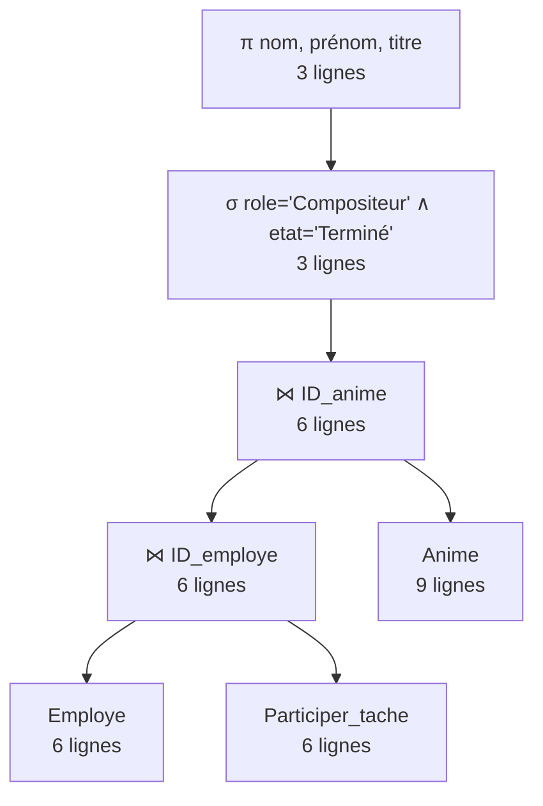
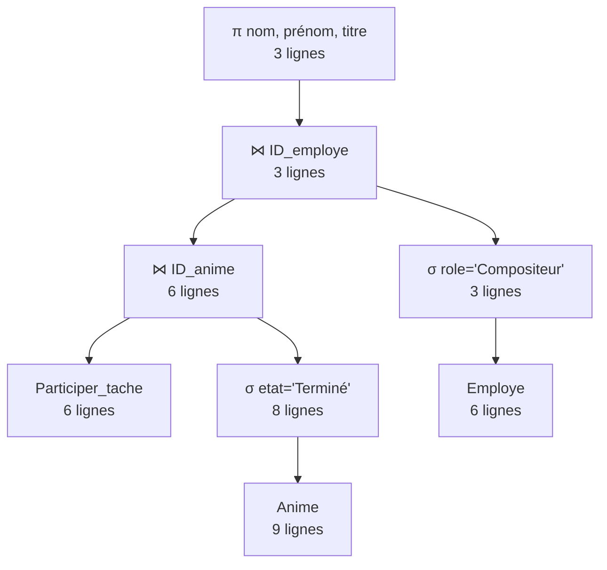
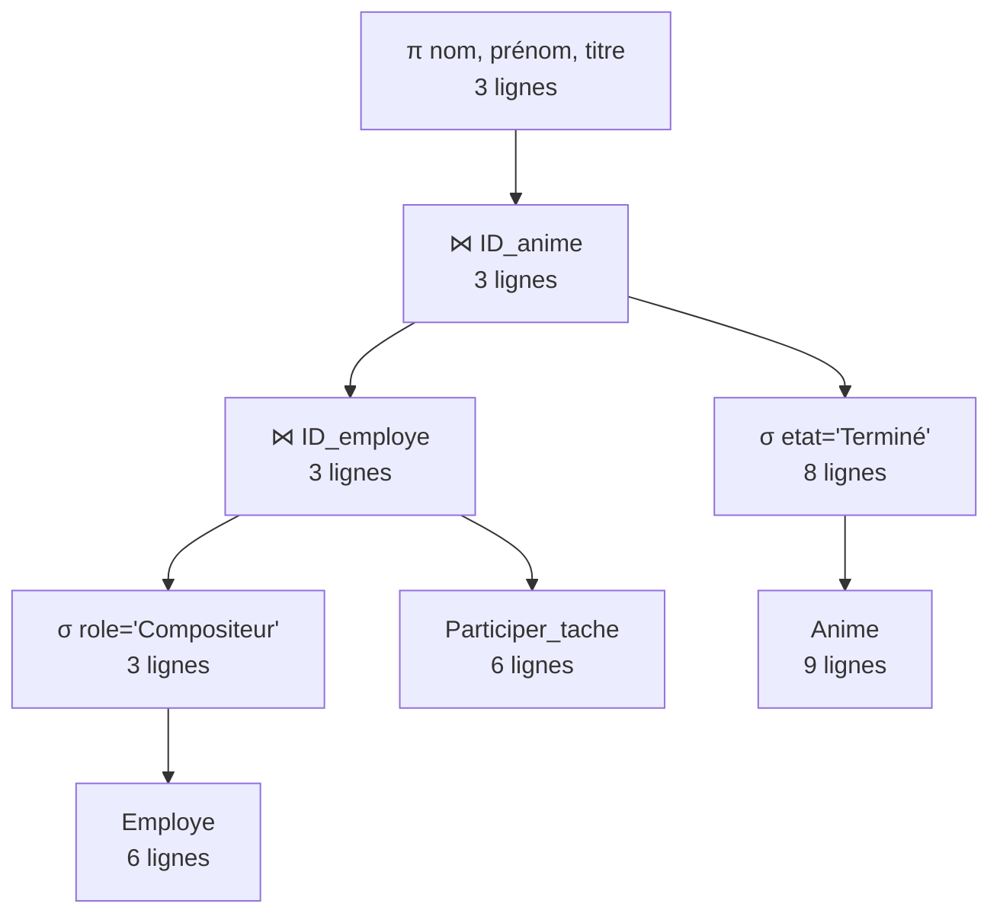

# ProjetDB_Zhan_Lin
Mini projet de base de donnée
29/09/2026 15:39
On a modifié le dictionnaire que l'IAG nous proposé, on a suppprimé les attributs : Territoire Géographique, Fonction de l'employer, Adresse éléctronique pro

MLD :

Auteur =(ID_auteur, Nom)
Editeur =(ID_editeur, nom_editeur)
Realisateur =(ID_Realisateur, Nom_Realisateur)
Genre =(ID_genre, genre)
Employe =(ID_employe, nom_employe, prenom_employe, date_embauche, role_employe, #ID_anime)
Prestataire =(ID_entreprise, specialite, nom_prestataire)
Diffuseur =(ID_diffuseur, nom_diffuseur, type_diffuseur, date_debut_droit, date_fin_diffusion, montant_contrat)

Manga = (ID_manga, Titre, Nombre_de_Tomes, Date_de_publication, #ID_auteur #ID_editeur) 
Anime =(ID_anime, titre_anime, format, date_debut_prod, budget, etat, #ID_manga, #ID_Realisateur)  
Saison=(ID_saison, num_saison, date_sortie_saison, #ID_anime)     
Episode=(ID_episode, numero_episode, titre_episode, duree, date_episode,#ID_saison,#ID_episode_précédent) 
Depense =(ID_depense, date_depense_production, montant, categorie_depense, motif, #ID_anime, )        

Manga_Genre =(#ID_manga, #ID_genre)                                                 
Anime_Genre =(#ID_anime, #ID_genre)                                                 
Participer_tache =(#ID_employe, #ID_episode,#ID_anime, role_specifique, nb_heure)    
Sous traiter = (#ID_entreprise, #ID_anime)         
Diffuser = (#ID_anime,#ID_diffuseur) 

## Étape 5 : Interrogation de la base

### 1. Scénario d'utilisation

**Utilisateur :** la directrice de production de Kōgetsu Animation.

**Contexte :** avant le comité de pilotage trimestriel, elle doit faire le point sur l'ensemble des productions du studio, et décider quelles adaptations lancer, où renforcer les équipes et si les budgets sont tenus.

**Données à extraire :**

| Besoin | Données recherchées | Requêtes |
|---|---|---|
| Piloter le catalogue | productions TV/Film en cours ou planifiées, formats utilisés, mangas à titre précis, prestataires d'animation | 1.1, 1.2, 1.3, 1.7 |
| Gérer les équipes | employés embauchés sur une période, charge de travail cumulée par employé, détail des tâches par épisode | 1.4, 2.5, 3.6, 4.4 |
| Suivre les finances | grosses dépenses, dépenses par catégorie et par production, dépassements de budget (dépenses réelles supérieures au budget prévisionnel) | 1.5, 2.2, 2.3, 2.4, 4.7, 4.8 |
| Gérer la diffusion | diffuseurs par production, contrats par type de diffuseur, productions sur le streaming | 1.6, 2.6, 3.4, 4.3 |
| Choisir les prochaines adaptations | mangas jamais adaptés, genres les plus représentés | 2.8, 3.2, 4.1 |
| Contrôler la production | nombre de saisons / épisodes / durée par production, chaînage des épisodes, productions sans saison, prestataires inutilisés | 2.1, 2.7, 3.1, 3.3, 3.5, 4.2, 4.9 |
| Comparer les productions | budget le plus élevé, séries plus chères qu'un film | 4.5, 4.6 |


---

### 2. Étude des plans d'exécution

#### Requête étudiée

*Besoin : quels compositeurs ont travaillé sur une production terminée ?*

```sql
SELECT DISTINCT e.nom_employe, e.prenom_employe, a.titre_anime
FROM Employe e
JOIN Participer_tache p ON p.ID_employe = e.ID_employe
JOIN Anime a ON a.ID_anime = p.ID_anime
WHERE e.role_employe = 'Compositeur'
  AND a.etat = 'Terminé';
```

Expression en algèbre relationnelle (3 opérateurs différents : σ, ⋈, π) :

π<sub>nom_employe, prenom_employe, titre_anime</sub>( σ<sub>role_employe='Compositeur' ∧ etat='Terminé'</sub>( (Employe ⋈ Participer_tache) ⋈ Anime ) )

#### Cardinalités réelles (relevées avec `COUNT(*)` sur la base)

| Table / ensemble | Nombre de lignes |
|---|---|
| Employe | 6 |
| Participer_tache | 6 |
| Anime | 9 |
| Employe avec role_employe = 'Compositeur' | 3 |
| Anime avec etat = 'Terminé' | 8 |

Les 6 participations concernent toutes des animes terminés ; 3 d'entre elles sont réalisées par des compositeurs. Le résultat final contient donc 3 lignes.

#### Modèle de coût

- Sélection σ ou projection π sur R : **|R|** instructions (chaque ligne est lue une fois) ;
- Jointure R ⋈ S (boucles imbriquées) : **|R| × |S|** instructions.

#### Plan A : jointures d'abord, sélection ensuite (plan naïf)



| Étape | Calcul | Instructions | Lignes obtenues |
|---|---|---|---|
| Employe ⋈ Participer_tache | 6 × 6 | 36 | 6 |
| ⋈ Anime | 6 × 9 | 54 | 6 |
| σ (rôle ∧ état) | 6 | 6 | 3 |
| π | 3 | 3 | 3 |
| **Total** | | **99** | |

#### Plan B : sélections descendues, jointure Participer_tache ⋈ Anime en premier



| Étape | Calcul | Instructions | Lignes obtenues |
|---|---|---|---|
| σ etat='Terminé' (Anime) | 9 | 9 | 8 |
| Participer_tache ⋈ σ(Anime) | 6 × 8 | 48 | 6 |
| σ role='Compositeur' (Employe) | 6 | 6 | 3 |
| ⋈ σ(Employe) | 6 × 3 | 18 | 3 |
| π | 3 | 3 | 3 |
| **Total** | | **84** | |

#### Plan C : sélections descendues, jointure σ(Employe) ⋈ Participer_tache en premier



| Étape | Calcul | Instructions | Lignes obtenues |
|---|---|---|---|
| σ role='Compositeur' (Employe) | 6 | 6 | 3 |
| σ etat='Terminé' (Anime) | 9 | 9 | 8 |
| σ(Employe) ⋈ Participer_tache | 3 × 6 | 18 | 3 |
| ⋈ σ(Anime) | 3 × 8 | 24 | 3 |
| π | 3 | 3 | 3 |
| **Total** | | **60** | |

#### Conclusion

| Plan | Instructions |
|---|---|
| A (jointures puis sélection) | 99 |
| B (σ descendues, Anime d'abord) | 84 |
| **C (σ descendues, Employe d'abord)** | **60** |

Le **plan C** est le plus efficace, environ 1,65 fois moins coûteux que le plan A. Cela peut s'expliquer par deux règles d'optimisation:

1. **Descendre les sélections** avant les jointures, on évite les gros produits comme Employe ⋈ Participer_tache sur toutes les lignes (36 instructions) et on ne joint que des lignes utiles.
2. **Joindre en premier la sélection la plus sélective.** Ici, la sélection sur le rôle garde 3 employés sur 6 (50 %), alors que la sélection sur l'état garde 8 animes sur 9 (89 %) et ne filtre presque rien. Il vaut donc mieux joindre d'abord `σ(Employe)` avec `Participer_tache` (plan C) que `σ(Anime)` (plan B). Avec un autre jeu de données, où peu d'animes seraient terminés, l'ordre optimal pourrait s'inverser.

**REMARQUE** : dans le fichier contrainte ,les contraintes « pas dans le futur » utilisent la date fixe '2026-11-08', car MySQL refuse CURRENT_DATE dans un CHECK


